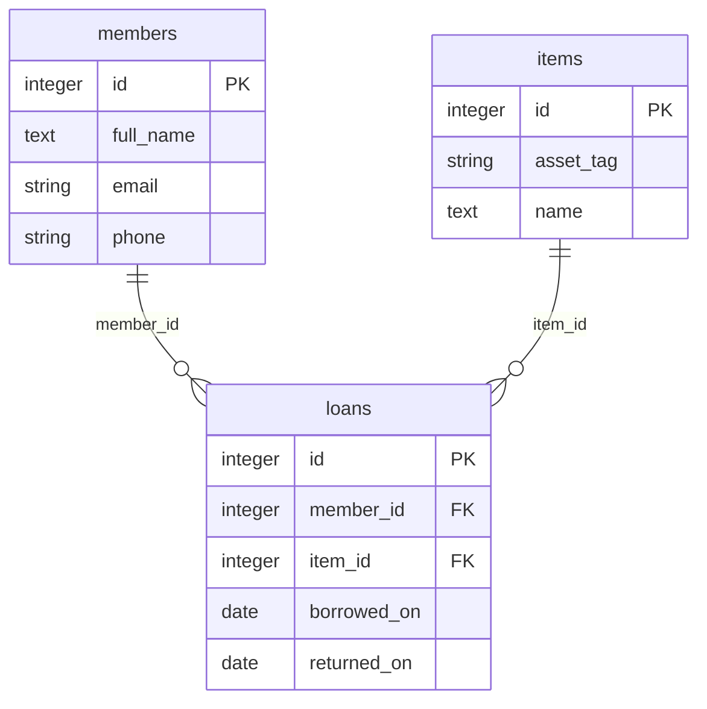

# Conceptual model — Equipment Lending Club Database

**Design version:** 3 · **Target:** SQLite

A single-user offline SQLite database for a small equipment-lending club. It tracks members with unique email and optional phone, items with unique asset tags, and loans with borrow/return dates. The schema enforces unique constraints, RESTRICT deletion on referenced members/items, and a CHECK constraint that returned_on is not before borrowed_on. The application ensures at most one open loan per item within a transaction. Security relies on OS file permissions and regular backups.

## Entities

### members

Club members with unique email and optional phone

### items

Lendable equipment items with unique asset tag

### loans

Loan records linking a member and an item with borrow and return dates

## Entity-relationship diagram

## Relationships and cardinality

- loans (member_id) → members (id): many-to-one; required parent; parent deletion: RESTRICT. A parent can have zero or many matching child records.
- loans (item_id) → items (id): many-to-one; required parent; parent deletion: RESTRICT. A parent can have zero or many matching child records.

## Business rules

- At most one open loan per item: enforced by the application within a transaction (not by a SQL constraint).
- returned_on must be >= borrowed_on when present: enforced by the SQL CHECK constraint loans_return_check.
- Email must be unique: enforced by the UNIQUE constraint on members.email.
- Asset tag must be unique: enforced by the UNIQUE constraint on items.asset_tag.
- Deletion of a member or item that has existing loans is restricted: enforced by ON DELETE RESTRICT on foreign keys.
- Loan history is retained indefinitely; no cascading deletes.
- All foreign keys (member_id, item_id) are mandatory and must reference existing rows.
