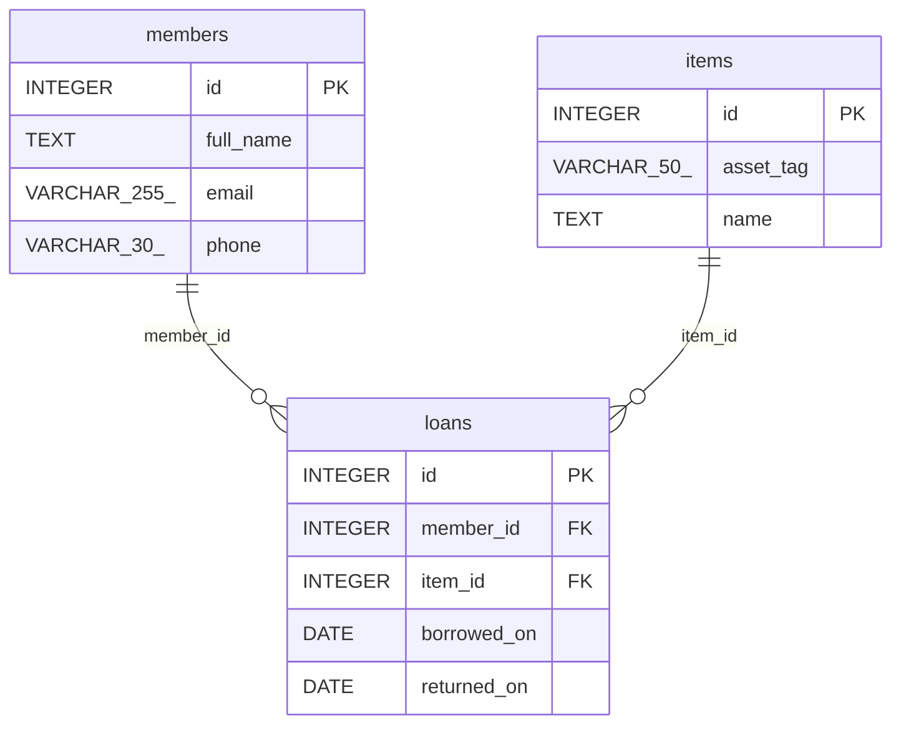

# Logical schema

**Design version:** 3 · **Target:** SQLite

Identifiers use portable lowercase snake_case. IDs are application-supplied; no auto-increment allocation is assumed.

## members

Club members with unique email and optional phone

| Column | Type | Nullable | Default | Description |
| --- | --- | --- | --- | --- |
| id | INTEGER | No | — | Unique member identifier assigned by the application |
| full_name | TEXT | No | — | Full name of the member |
| email | VARCHAR(255) | No | — | Unique email address, private contact data; uniqueness enforced by the database, format validated by the application |
| phone | VARCHAR(30) | Yes | — | Optional phone number, private contact data |

- **Primary key:** id
- **Unique keys:** (email)
- **Foreign keys:** None
- **Checks:** None
- **Compiler-added column domains:** length("email") <= 255; length("phone") <= 30
- **Declared indexes:** None
- **Automatic indexing:** primary/unique keys are indexed by the engine. The SQL compiler adds an index on each foreign-key column group not already covered by a leading primary/unique/declared index.
- **Sample rows:** 3

## items

Lendable equipment items with unique asset tag

| Column | Type | Nullable | Default | Description |
| --- | --- | --- | --- | --- |
| id | INTEGER | No | — | Unique item identifier assigned by the application |
| asset_tag | VARCHAR(50) | No | — | Unique asset tag identifier |
| name | TEXT | No | — | Human-readable name of the item |

- **Primary key:** id
- **Unique keys:** (asset_tag)
- **Foreign keys:** None
- **Checks:** None
- **Compiler-added column domains:** length("asset_tag") <= 50
- **Declared indexes:** None
- **Automatic indexing:** primary/unique keys are indexed by the engine. The SQL compiler adds an index on each foreign-key column group not already covered by a leading primary/unique/declared index.
- **Sample rows:** 3

## loans

Loan records linking a member and an item with borrow and return dates

| Column | Type | Nullable | Default | Description |
| --- | --- | --- | --- | --- |
| id | INTEGER | No | — | Unique loan identifier assigned by the application |
| member_id | INTEGER | No | — | Foreign key to members.id |
| item_id | INTEGER | No | — | Foreign key to items.id |
| borrowed_on | DATE | No | — | UTC date (YYYY-MM-DD) when the item was borrowed |
| returned_on | DATE | Yes | — | UTC date (YYYY-MM-DD) when the item was returned, null if still out |

- **Primary key:** id
- **Unique keys:** None beyond primary key
- **Foreign keys:** (member_id) → members(id); ON DELETE RESTRICT; (item_id) → items(id); ON DELETE RESTRICT
- **Checks:** loans_return_check: returned_on IS NULL OR returned_on >= borrowed_on
- **Compiler-added column domains:** None beyond declared types
- **Declared indexes:** loans_item_returned_idx (item_id, returned_on); loans_member_idx (member_id)
- **Automatic indexing:** primary/unique keys are indexed by the engine. The SQL compiler adds an index on each foreign-key column group not already covered by a leading primary/unique/declared index.
- **Sample rows:** 4

## Relational schema diagram

## Security and privacy

- The SQLite database file is protected by operating system file permissions (e.g., read/write for the librarian only).
- Regular backups of the database file should be maintained to prevent data loss.
- Emails and phone numbers are private contact data; consider encrypting the database file if required by policy.
- No authentication table; access is via the application which is used solely by the trusted librarian.

Security policies below are architectural requirements. Application authentication, encryption at rest, and production DB role provisioning must be implemented at deployment; the SQL export does not invent credentials or create privileged users.

## Compiler-added foreign-key indexes

None required.
