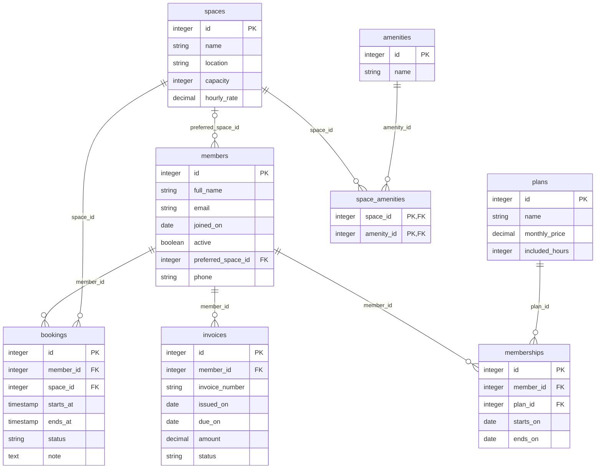

# Conceptual model — Lumina coworking platform

**Design version:** 2 · **Target:** PostgreSQL

A normalized relational model separates members, product plans, subscription history, spaces, shared amenities, reservations, and invoices. An associative table represents shared amenities. Financial and reservation history remain linked to anonymizable member records.

## Entities

### members

Member identity, optional preferred space and contact information, separable from retained financial history.

### plans

Subscription products with stable pricing and included workspace hours.

### memberships

Effective-dated member subscriptions preserving plan enrollment history.

### spaces

Bookable rooms and desks, each with a location label, capacity and hourly rate.

### amenities

Reusable amenity definitions shared by multiple bookable spaces.

### space_amenities

Associative relation implementing the many-to-many space-to-amenity relationship.

### bookings

UTC reservation intervals with lifecycle state and an optional member-supplied note.

### invoices

Retained member invoices independent of optional booking activity; no payment card data.

## Entity-relationship diagram

## Relationships and cardinality

- members (preferred_space_id) → spaces (id): many-to-one; optional parent; parent deletion: SET NULL. A parent can have zero or many matching child records.
- memberships (member_id) → members (id): many-to-one; required parent; parent deletion: RESTRICT. A parent can have zero or many matching child records.
- memberships (plan_id) → plans (id): many-to-one; required parent; parent deletion: RESTRICT. A parent can have zero or many matching child records.
- space_amenities (space_id) → spaces (id): many-to-one; required parent; parent deletion: CASCADE. A parent can have zero or many matching child records.
- space_amenities (amenity_id) → amenities (id): many-to-one; required parent; parent deletion: CASCADE. A parent can have zero or many matching child records.
- bookings (member_id) → members (id): many-to-one; required parent; parent deletion: RESTRICT. A parent can have zero or many matching child records.
- bookings (space_id) → spaces (id): many-to-one; required parent; parent deletion: RESTRICT. A parent can have zero or many matching child records.
- invoices (member_id) → members (id): many-to-one; required parent; parent deletion: RESTRICT. A parent can have zero or many matching child records.

## Business rules

- Unique member emails, plan names, amenity names, invoice numbers, and space names within a location are enforced by UNIQUE keys.
- Positive capacity, nonnegative amounts/hours/rates, permitted lifecycle states, and ordered dates are enforced with CHECK constraints.
- Foreign keys retain member/booking/invoice history through RESTRICT/NO ACTION. Only pure amenity links cascade.
- No overlapping confirmed bookings: the application must lock the space row and query intersecting intervals in the same transaction before insertion. For SQLite use BEGIN IMMEDIATE and serialize writes. Row-level CHECK constraints do not enforce this cross-row rule.
- Back-to-back bookings are valid half-open intervals. Cancelled bookings do not block availability.
- Member data access and location-scoped staff access require application authorization; invoice visibility is limited to billing administrators.
- Member contact details can be anonymized while the member identifier and invoices remain for seven-year billing retention.
- Changing booking and invoice status requires an authorized atomic transaction; payment processing uses idempotency at the integration boundary.
