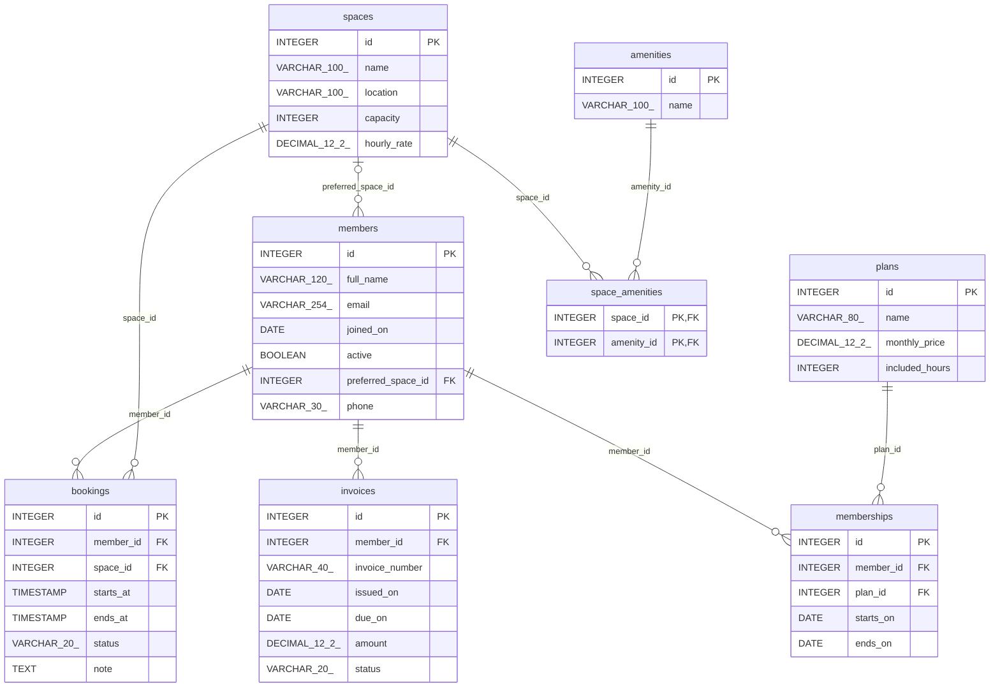

# Logical schema

**Design version:** 2 · **Target:** PostgreSQL

Identifiers use portable lowercase snake_case. IDs are application-supplied; no auto-increment allocation is assumed.

## members

Member identity, optional preferred space and contact information, separable from retained financial history.

| Column | Type | Nullable | Default | Description |
| --- | --- | --- | --- | --- |
| id | INTEGER | No | — | Application-assigned member identifier |
| full_name | VARCHAR(120) | No | — | Member display name |
| email | VARCHAR(254) | No | — | Unique member contact address |
| joined_on | DATE | No | — | Registration date |
| active | BOOLEAN | No | — | Whether the account may create bookings |
| preferred_space_id | INTEGER | Yes | — | Optional preferred space; preferences never imply a reservation |
| phone | VARCHAR(30) | Yes | — | Optional member phone number in international format |

- **Primary key:** id
- **Unique keys:** (email)
- **Foreign keys:** (preferred_space_id) → spaces(id); ON DELETE SET NULL
- **Checks:** None
- **Declared indexes:** None
- **Automatic indexing:** primary/unique keys are indexed by the engine. The SQL compiler adds an index on each foreign-key column group not already covered by a leading primary/unique/declared index.
- **Sample rows:** 3

## plans

Subscription products with stable pricing and included workspace hours.

| Column | Type | Nullable | Default | Description |
| --- | --- | --- | --- | --- |
| id | INTEGER | No | — | Plan identifier |
| name | VARCHAR(80) | No | — | Unique plan label |
| monthly_price | DECIMAL(12,2) | No | — | Monthly price in USD |
| included_hours | INTEGER | No | — | Included monthly booking hours |

- **Primary key:** id
- **Unique keys:** (name)
- **Foreign keys:** None
- **Checks:** plans_nonnegative: monthly_price >= 0 AND included_hours >= 0
- **Declared indexes:** None
- **Automatic indexing:** primary/unique keys are indexed by the engine. The SQL compiler adds an index on each foreign-key column group not already covered by a leading primary/unique/declared index.
- **Sample rows:** 3

## memberships

Effective-dated member subscriptions preserving plan enrollment history.

| Column | Type | Nullable | Default | Description |
| --- | --- | --- | --- | --- |
| id | INTEGER | No | — | Membership identifier |
| member_id | INTEGER | No | — | Subscribed member |
| plan_id | INTEGER | No | — | Subscribed plan |
| starts_on | DATE | No | — | First active date |
| ends_on | DATE | Yes | — | Exclusive end date; null means ongoing |

- **Primary key:** id
- **Unique keys:** (member_id, starts_on)
- **Foreign keys:** (member_id) → members(id); ON DELETE RESTRICT; (plan_id) → plans(id); ON DELETE RESTRICT
- **Checks:** memberships_date_order: ends_on IS NULL OR ends_on > starts_on
- **Declared indexes:** None
- **Automatic indexing:** primary/unique keys are indexed by the engine. The SQL compiler adds an index on each foreign-key column group not already covered by a leading primary/unique/declared index.
- **Sample rows:** 3

## spaces

Bookable rooms and desks, each with a location label, capacity and hourly rate.

| Column | Type | Nullable | Default | Description |
| --- | --- | --- | --- | --- |
| id | INTEGER | No | — | Space identifier |
| name | VARCHAR(100) | No | — | Name unique inside location |
| location | VARCHAR(100) | No | — | Location label; locations have no other attributes in this scope |
| capacity | INTEGER | No | — | Maximum occupants |
| hourly_rate | DECIMAL(12,2) | No | — | Booking rate in USD per hour |

- **Primary key:** id
- **Unique keys:** (location, name)
- **Foreign keys:** None
- **Checks:** spaces_valid_capacity_rate: capacity > 0 AND hourly_rate >= 0
- **Declared indexes:** None
- **Automatic indexing:** primary/unique keys are indexed by the engine. The SQL compiler adds an index on each foreign-key column group not already covered by a leading primary/unique/declared index.
- **Sample rows:** 3

## amenities

Reusable amenity definitions shared by multiple bookable spaces.

| Column | Type | Nullable | Default | Description |
| --- | --- | --- | --- | --- |
| id | INTEGER | No | — | Amenity identifier |
| name | VARCHAR(100) | No | — | Unique amenity label |

- **Primary key:** id
- **Unique keys:** (name)
- **Foreign keys:** None
- **Checks:** None
- **Declared indexes:** None
- **Automatic indexing:** primary/unique keys are indexed by the engine. The SQL compiler adds an index on each foreign-key column group not already covered by a leading primary/unique/declared index.
- **Sample rows:** 3

## space_amenities

Associative relation implementing the many-to-many space-to-amenity relationship.

| Column | Type | Nullable | Default | Description |
| --- | --- | --- | --- | --- |
| space_id | INTEGER | No | — | Equipped space |
| amenity_id | INTEGER | No | — | Available amenity |

- **Primary key:** space_id, amenity_id
- **Unique keys:** None beyond primary key
- **Foreign keys:** (space_id) → spaces(id); ON DELETE CASCADE; (amenity_id) → amenities(id); ON DELETE CASCADE
- **Checks:** None
- **Declared indexes:** None
- **Automatic indexing:** primary/unique keys are indexed by the engine. The SQL compiler adds an index on each foreign-key column group not already covered by a leading primary/unique/declared index.
- **Sample rows:** 5

## bookings

UTC reservation intervals with lifecycle state and an optional member-supplied note.

| Column | Type | Nullable | Default | Description |
| --- | --- | --- | --- | --- |
| id | INTEGER | No | — | Booking identifier |
| member_id | INTEGER | No | — | Booking owner |
| space_id | INTEGER | No | — | Reserved space |
| starts_at | TIMESTAMP | No | — | Inclusive start, UTC |
| ends_at | TIMESTAMP | No | — | Exclusive end, UTC |
| status | VARCHAR(20) | No | — | Reservation lifecycle |
| note | TEXT | Yes | — | Optional booking request |

- **Primary key:** id
- **Unique keys:** None beyond primary key
- **Foreign keys:** (member_id) → members(id); ON DELETE RESTRICT; (space_id) → spaces(id); ON DELETE RESTRICT
- **Checks:** bookings_interval: ends_at > starts_at; bookings_status: status IN ('confirmed', 'completed', 'cancelled')
- **Declared indexes:** bookings_availability_idx (space_id, starts_at, ends_at); bookings_member_history_idx (member_id, starts_at)
- **Automatic indexing:** primary/unique keys are indexed by the engine. The SQL compiler adds an index on each foreign-key column group not already covered by a leading primary/unique/declared index.
- **Sample rows:** 3

## invoices

Retained member invoices independent of optional booking activity; no payment card data.

| Column | Type | Nullable | Default | Description |
| --- | --- | --- | --- | --- |
| id | INTEGER | No | — | Invoice identifier |
| member_id | INTEGER | No | — | Billed member retained as an anonymizable FK target |
| invoice_number | VARCHAR(40) | No | — | Unique business invoice reference |
| issued_on | DATE | No | — | Issue date |
| due_on | DATE | No | — | Payment deadline |
| amount | DECIMAL(12,2) | No | — | Invoice amount in USD |
| status | VARCHAR(20) | No | — | Payment lifecycle |

- **Primary key:** id
- **Unique keys:** (invoice_number)
- **Foreign keys:** (member_id) → members(id); ON DELETE RESTRICT
- **Checks:** invoices_amount: amount >= 0; invoices_dates: due_on >= issued_on; invoices_status: status IN ('draft', 'paid', 'overdue')
- **Declared indexes:** invoices_status_due_idx (status, due_on)
- **Automatic indexing:** primary/unique keys are indexed by the engine. The SQL compiler adds an index on each foreign-key column group not already covered by a leading primary/unique/declared index.
- **Sample rows:** 3

## Relational schema diagram

## Security and privacy

- No passwords, payment cards, or real personal data are seeded. Example contact addresses use example.org.
- Separate member, location-staff, and billing-administrator permissions in the application and production database roles.
- Encrypt transport and backups; minimize contact data and audit access to billing information.
- Retain invoices seven years and booking history two years; anonymize member contact information without breaking retained FKs.
- Member phone numbers are optional private contact details; restrict access and include them in anonymization.

Security policies below are architectural requirements. Application authentication, encryption at rest, and production DB role provisioning must be implemented at deployment; the SQL export does not invent credentials or create privileged users.

## Compiler-added foreign-key indexes

| Table | Index | Columns |
| --- | --- | --- |
| members | fk_members_0_fi7imo | preferred_space_id |
| memberships | fk_memberships_1_1gk8tjy | plan_id |
| space_amenities | fk_space_amenities_1_nxxwuh | amenity_id |
| invoices | fk_invoices_0_1vs3wex | member_id |
